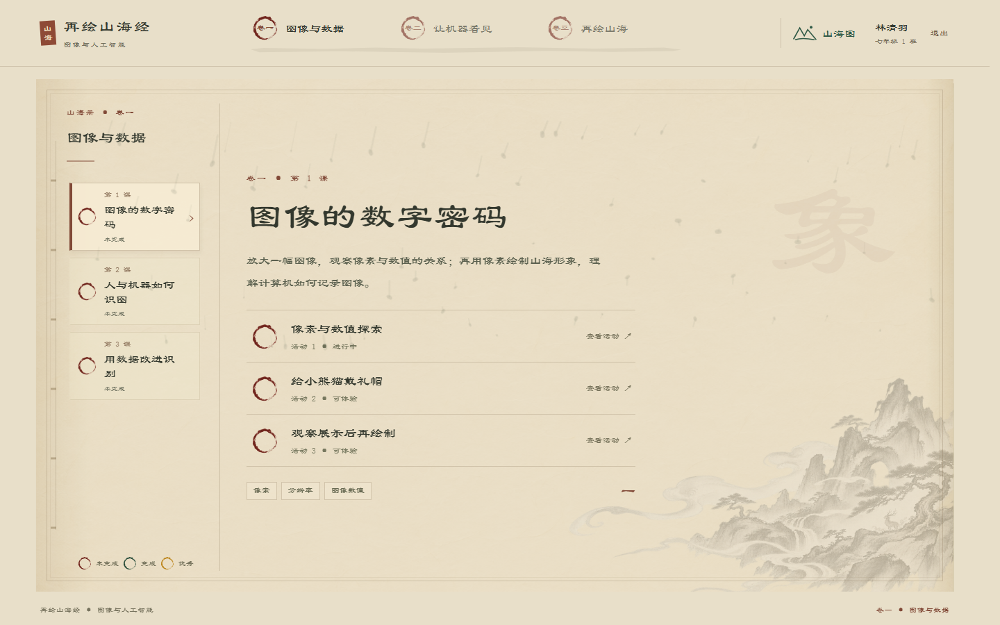
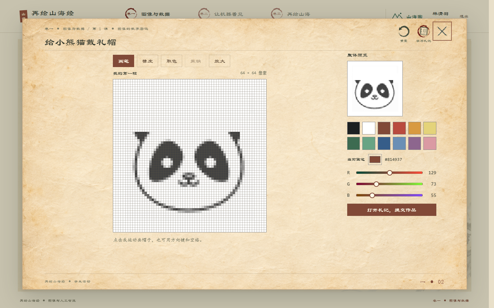
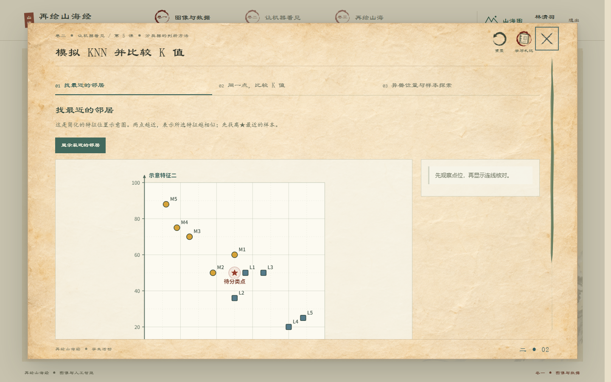
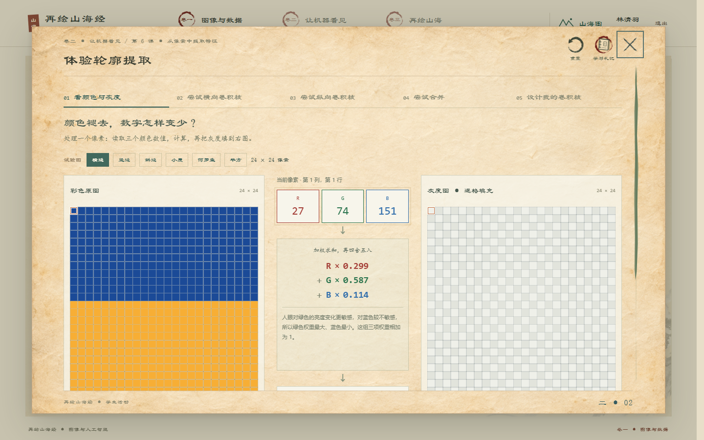
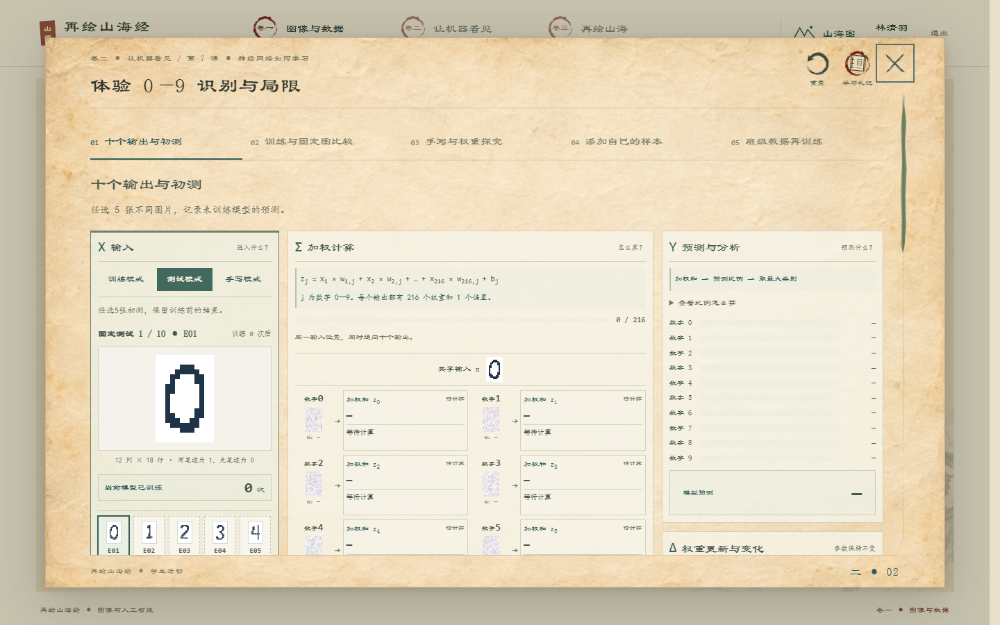
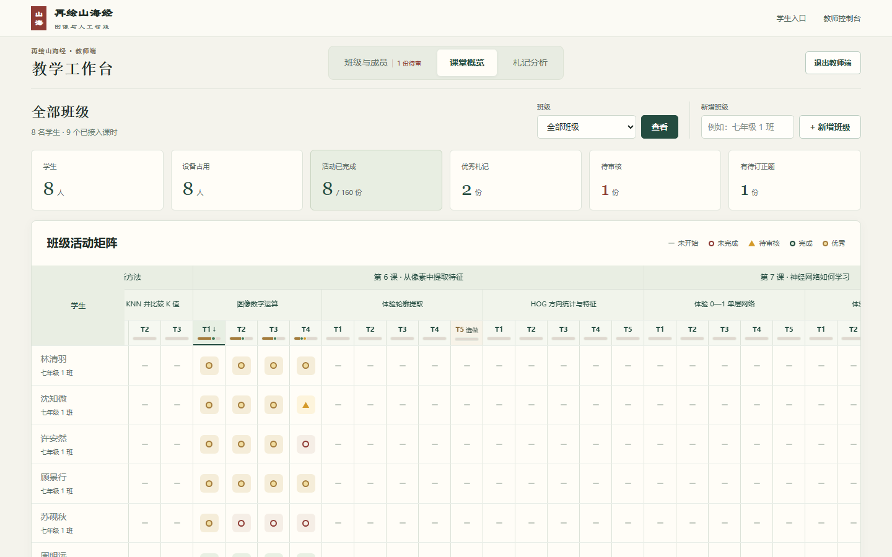

# 再绘山海经 · AI 课堂平台

面向初中（七年级）人工智能与跨学科教学的本地化课堂实验平台。项目以《山海经》古籍与山海图鉴为情境主线，将**数字图像编码、机器学习分类、特征提取、神经网络与生成式创作**融入 3 卷 9 课的渐进式交互实验中，并配套局域网教师控制台与学习札记系统。



## 平台特点

- **三卷九课完整体系**：从「像素与数值」出发，依次经历「动物分类与数据改进」「决策树与 KNN」「像素运算 / 卷积边缘 / HOG」「0—9 单层神经网络」直至「《山海经》AI 协同创作」。
- **浏览器内真实交互实验**：所有核心算法与可视化实验均在浏览器本地运行（含本地图像分类训练、卷积核步进、神经网络权重可视化等），机房无外网环境也能稳定授课。
- **教—学—评一体化闭环**：学生端内置「学习札记」（无感草稿暂存、客观题自动判分与订正、主观题与作品提交、红/绿/金圈进度反馈）；教师端提供班级与设备绑定管理、课堂概览矩阵（支持悬浮详情与按子活动排序）、逐题学情分析、高频词云及作品选展。
- **零部署门槛**：提供 Windows 一键包与图形化启动器，局域网开箱即用，课堂数据纯本地 SQLite 存储。

## 课程体系与知识点一览

| 卷别 | 课时 | 核心课堂活动 | 涉及知识点 |
| :--- | :--- | :--- | :--- |
| **卷一 · 象**<br>图像与数据 | 第 1 课 图像的数字密码 | 像素与数值探索、64×64 像素画创作与二次改绘 | 像素、分辨率、二值/灰度编码、RGB 三通道 |
| | 第 2 课 人与机器如何识图 | 人工识图依据、金丝猴/雪豹分类器训练与测试 | 图像分类、训练集与测试集、特征迁移推理 |
| | 第 3 课 用数据改进识别 | 复盘识别误差、补充样本重训与前后对照 | 数据质量、样本多样性、控制变量对照实验 |
| **卷二 · 识**<br>让机器看见 | 第 4 课 当分类器遇见异兽 | 四类现实动物训练、山海异兽测试与全班均值对比 | 多分类、封闭集局限、数据/算法/算力边界 |
| | 第 5 课 分类器的判断方法 | 搭建决策树、模拟 KNN 坐标与 K 值对比 | 特征划分、决策树、KNN 邻近度与 K 值影响 |
| | 第 6 课 从像素中提取特征 | 图像数字运算、卷积核轮廓提取、HOG 方向统计 | 像素矩阵运算、卷积滤波、边缘与 HOG 特征 |
| | 第 7 课 神经网络如何学习 | 0—1 单层网络、0—9 手写识别与全班样本库再训练 | 加权求和、误差反馈、权重可视化与单层网络局限 |
| **卷三 · 绘**<br>再绘山海 | 第 8 课 循文绘兽：初绘山海 | AI 识图核对、依《山海经》原文生图与维度打分 | 多模态识图、原文转译、作品评价标准 |
| | 第 9 课 炼词成画：再绘山海 | 动物灵气初创、班级自由观展采集、定稿与 AI 复盘 | 结构化提示词、迭代优化、人机协同反思 |

## 界面与活动预览

| 第 1 课 · 64×64 像素画与 RGB 调色 | 第 5 课 · KNN 特征坐标与 K 值模拟 |
| :---: | :---: |
|  |  |
| **第 6 课 · 灰度转换与卷积轮廓提取** | **第 7 课 · 0—9 单层神经网络与权重探究** |
|  |  |

**教师控制台 · 课堂概览矩阵**（支持全班子活动进度一览、悬浮查看详情与点击子活动列排序）：



## 方式一：直接下载一键包（推荐给授课教师）

如果你只是希望直接在课堂上使用，无需安装 Python 或配置环境：

1. 前往本仓库右侧的 **Releases** 页面，下载最新版本的 Windows 一键包（如 `shanhai-ai-v1.0.1-win64.zip`）。
2. 将压缩包完整解压到任意目录（不要直接在压缩包内运行）。
3. 双击 `启动课堂.bat` 打开图形化启动器，点击 **▶ 启动课堂服务** 即可。

详细操作与备份/重置密码说明可参考目录内的 [使用说明.txt](使用说明.txt)。

## 方式二：从源码运行（推荐给开发者）

### 环境要求

- Python 3.10+（推荐 Python 3.11）
- 如需运行图形化启动器 `launcher.py`，需确保 Python 环境包含 `tkinter`

### 安装与启动

```bash
# 1. 克隆仓库
git clone https://github.com/Launcher-Z/shanhai_ai.git
cd shanhai_ai

# 2. 创建并激活虚拟环境
python -m venv .venv
# Windows:
.venv\Scripts\activate
# macOS / Linux:
# source .venv/bin/activate

# 3. 安装依赖
pip install -r requirements.txt

# 4. 启动方式 A：运行图形化启动器（推荐）
python launcher.py

# 4. 启动方式 B：直接运行服务入口
python app.py
```

### 常用环境变量（直接运行 `app.py` 时生效）

| 变量 | 说明 | 默认值 |
| --- | --- | --- |
| `SHANHAI_RUN_MODE` | `waitress`（局域网课堂模式）或 `dev`（本机调试模式） | `waitress` |
| `SHANHAI_PORT` | 服务监听端口 | `5000` |
| `SHANHAI_THREADS` | Waitress 并发线程数 | `8` |
| `SHANHAI_PROGRESS_LOCKS` | 是否开启课程与札记顺序解锁（`true` / `false`） | `true` |

## 课堂使用流程

1. 启动服务后访问教师控制台：`http://127.0.0.1:5000/teacher`。
2. 首次使用先设置不少于 8 位的教师密码，并创建上课班级。
3. 学生在同一局域网内通过教师机 IP 与端口（如 `http://192.168.x.x:5000`）访问学习首页，选择班级并输入姓名即可进入实验。
4. 课堂数据库与会话密钥默认保存在本地 `data/` 目录（`classroom.sqlite3` 与 `session.key`），已被 `.gitignore` 排除。

## 目录结构

```text
.
├── app.py                 # 服务启动入口
├── launcher.py            # Tkinter 图形化课堂启动器
├── launcher_config.json   # 启动器默认配置
├── requirements.txt       # Python 依赖清单
├── shanhai/               # Flask 应用、路由、数据库与教学逻辑
├── templates/             # 页面模板（学习页、活动页、教师端）
├── static/                # 静态资源、交互脚本、本地模型与图鉴素材
├── worksheets/            # 各课时学习札记题目配置
├── data/                  # 运行时数据库与密钥目录（本地生成）
├── 使用说明.txt           # 一键包教师使用说明
└── 启动课堂.bat           # Windows 一键包启动脚本
```

## 更新说明

### v1.0.1
- **教师台加载性能优化**：开启 SQLite WAL 模式、缓存课程目录与进度节点、消除统计时的嵌套遍历与重复 JSON 解析、启用响应 gzip 压缩，并将「札记分析」改为按单课按需加载（保留「全部课时」切换入口）。
- **教师台交互改进**：
  - 「札记分析」使用左侧全课程目录切换课时（卷一/二/三仅作折叠分组，点回当前课原地收起已展开的活动而不刷新页面），并移除上方冗余的课时下拉框；
  - 像素画（1.2 / 1.3）、创作作品（8.2 / 9.1 / 9.3）及手写样本库（7.2）新增「刷新作品 / 刷新样本」按钮；
  - 「课堂概览」中尚未开始的任务改用浅灰色 `-` 展示，与已开始但未完成的红点区分。
- **局域网 HTTPS 与证书管理**：新增 `shanhai/certs.py` 自动签发局域网自签名 HTTPS 证书；启动器支持勾选 HTTPS 启动（含可关闭的访问提醒弹窗），以及一键导出根证书并附带 `HTTPS证书安装说明.txt`。

## 开源协议与素材声明

- 本项目源代码采用 **MIT License** 开源，详见 [LICENSE](LICENSE)。
- `static/` 下部分暂留的书籍拍摄图片、教学图片及第三方模型/前端库适用独立版权声明，**不纳入 MIT 授权范围**，详见 [NOTICE.md](NOTICE.md)。
